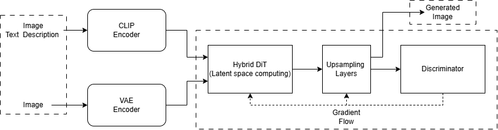

# **Разработка и сравнение классической и гибридной архитектур диффузионных моделей для генерации аниме-изображений.**

 

## **Состав команды**
- <h2>Белов Е.О.</h2>
- <h2>Савеленко М.Я.</h2>

## **Куратор**
- <h2>Ширнин А.А.</h2>

 

## **План работы**

### **Этап 2. Литературный обзор и проектировка** 
Исследование и анализ реализованных индустриальных подходов к решению задачи. Проектирование архитектуры разрабатываемой модели.
### **Этап 3. Разработка прототипа** 
Проектирование каркаса классической модели и интеграция валидационных метрик.
### **Этап 4. Программная инкапсуляция** 
Разработка сервиса/бота и воспроизводимой обертки вокруг модели для унификации процессов предобработки данных, обучения и инференса. 
### **Этап 5. Проектирование гибридной архитектуры** 
Проектирование и разработка гибридной модели для проверки гипотезы о повышении качества генерации.
### **Этап 6. Бенчмаркинг и сравнительный анализ** 
Экспериментальное сопоставление разработанного baseline, гибридного решения и внешней готовой модели на тестовом датасете.
### **Этап 7. Презентация результатов** 
Формирование финальной отчетности и подготовка доклада команды о проделанной R&D-работе.

---

## **Практическая применимость проекта**

Практическая польза разрабатываемой модели состоит в её архитектуре. U-net подобные модели диффузии часто страдают от размытости генерируемых ими картинок, GAN модели нестабильны во время обучения, при их обучении часто возникают взрыв градиентов и mode collapse. Разрабатываемая в рамках данного проекта архитектура обладает двумя важными вещами: использование трансформеров в связке с дискриминатором от моделей прошлого поколения - GAN и кастомный умный параметр в функции потерь для дискриминатора во время обучения всей гибридной архитектуры.

Практическая значимость проекта состоит в том, что умный параметр модели для дискриминатора позволяет ей обучаться более гладко и стабильно. Данная работа будет полезна для сервисов, которые занимаются генерацией картинок на тему аниме, например Pixai.art. Также данная модель была бы полезна для начинающих авторов аниме-комиксов/манги, разработчиков визуальных аниме-новелл и просто обычных пользователей для создания качественной генерации изображений аниме-персонажей.

Всё выше указанное выделяет нашу модель, так как обучение будет более стабильным из-за параметра, а сами генерируемые картинки будут более чёткими благодаря архитектуре-связки трансформера с дискриминатором. Это решает проблему инженеров, которые проектируют подобные архитектуры моделей.

Возможными проблемами данной модели могут быть: проблема контекста из-за сложности изображений и проблема оптимизации для видеокарты T4 для обработки изображений во время обучения.

---

## **Схема архитектуры разрабатываемой гибридной модели DiT**

1. CLIP Encoder:   Блок кодирования текстовых описаний изображений.
2. VAE Encoder:   Блок кодирования изображений.
3. Hybrid DiT:   Блок трансформерных слоёв, обрабатывающих входные закодированные данные в латентном пространстве.
4. Upsampling Layers:   Блок слоёв для развёртывания изображений.
5. Discriminator:   Блок оценки истинных и сгенерированных изображений.

---

## **Литературный обзор**

Статья: "Состязательно-диффузионная дистилляция (Adversarial Diffusion Distillation)" 

Авторы: Axel Sauer, Dominik Lorenz, Andreas Blattmann, Robin Rombach (Декабрь, 2023)

Ссылка: https://arxiv.org/pdf/2311.17042

Метод ADD позволяет превращать базовые диффузионные модели в генераторы, способные за 1-4 шага создавать высококачественные изображения, которые сильно превосходят по качеству изображения своих современнейших конкурентов. Для этого используется состязательное обучение и дистилляция оценок. Есть учитель (предобученная заранее диффузионная модель), есть ADD-ученик и дискриминатор. Ученик получает исходное зашумленное изображение, которое после “разшумления”, в свою очередь, снова зашумляется и передается учителю, который используя свои заранее “замороженные” параметры (веса) “разшумляет” изображение. Далее сравнивается полученное изображение с изображением полученным учеником; измеряется дистанция между ними. Эта измеренная дистанция есть дистилляционная потеря, чем она выше, тем сильнее различаются изображения учителя и ученика (значит нужно подбирать параметры ученика так, чтоб эта потеря была минимальной, чтоб изображения ученика всё больше походили на изображения учителя). Параллельно дискриминатор определяет реалистичное получилось изображение или нет. Он сравнивает реальные изображения и изображения ученика, причем ученик, в свою очередь, учится выдавать результаты, чтоб дискриминатор считал их за реальные.

Плюсы:

ADD-метод в ультрабыстром режиме 1-2 шагов превосходит другие конкурентные  методы в данной области; например, ADD-XL в 1 шаг превосходит LCM-XL с 4 шагами. При 4 шагах может обойти даже SDXL с 50 шагами. Изображения чаще соответствуют заданному людьми промпту. Люди чаще выбирают изображения сгенерированные ADD-методом.

Минусы:

Несколько ниже разнообразие генерируемых сэмплов. Реализм усиливается за счет сокращения разнообразия. 
1 шаг уже дает превосходное качество, но дополнительные шаги улучшают согласованность изображения и внимание к деталям. Генерация за 1 шаг не означает, что дальше улучшать уже нечего.

---
 

Статья: "Решение трилеммы генеративного обучения с помощью диффузионных GAN с шумоподавлением (Tackling the Generative Learning Trilemma with Denoising Diffusion GANs)"

Авторы: Zhisheng Xiao, Karsten Kreis, Arash Vahdat (2022)

Ссылка: https://arxiv.org/pdf/2112.07804

Существует трилемма генеративного обучения: как создать модель, которая одновременно способна быстро генерировать изображения с минимальными затратами, с максимальным разнообразием и модальным покрытием, и с максимальным качеством? Для этого создали так называемую GAN модель с шумоподавлением. Она представляет из себя диффузионную модель, обратный процесс которой параметризован моделью GAN с условием. Известно, что Гауссовское допущение работает только для маленьких шагов шумоподавления, оно не способно точно воспроизвести шумоподавление изображения в несколько больших шагов. Для этого с помощью GAN модели с условием это допущение заменяется на сложное мультимодальное распределение, которое обеспечивает шумоподавление за несколько больших шагов, вместо множества маленьких.

Плюсы:

Данная модель позволяет в большей степени решить вопрос данной трилеммы, то есть она обеспечивает высокую скорость генерации с относительно минимальной затратностью (в сравнении с конкурентными диффузионными и GAN моделями), относительно высокое качество изображений, сравнимое или выше с конкурентными моделями, а также хорошее разнообразие и модальное покрытие (разнообразие данных, которые модель способна воспроизвести). Что в сумме позволяет успешно использовать данную модель для решения различных задач реального мира.

Минусы:

Если попытаться использовать только один шаг шумоподавления, то качество и разнообразие очень сильно падают. Причем если использовать 2-4 шага достигаются наилучшие результаты, а если шагов >4, то снова происходит ухудшение качества и возрастает затратность, так как для каждого шага шумоподавления необходима своя GAN модель с условием.

По максимальному качеству изображений часть диффузионных моделей остается лучше, хоть и количество шагов у этих моделей остается намного выше данной модели. Тем не менее, изображения всё равно получаются довольно конкурентноспособными.

---
 

Статья: "Масштабируемые диффузионные модели на базе трансформеров (Scalable Diffusion Models with Transformers)"

Авторы: William Peebles, Saining Xie (2023)

Ссылка: https://arxiv.org/pdf/2212.09748

Диффузионные модели на базе трансформера представляют собой стандартную диффузионную модель, но “позвоночник” которой вместо обычного U-Net заменен на трансформер, который использует для работы так называемые “латентные патчи” (то есть изображения переводятся в латентное пространство, далее эти цифровые векторы данных делятся на токены и подаются на трансформер для дальнейшей обработки). 

Сложность математических операций измеряется в Gflops, близость распределения реальных и сгенерированных изображений измеряется в FID (чем FID меньше, тем качественнее и реалистичнее изображение). Было обнаружено, что чем выше сложность (количество слоев трансформера/размерность представления токенов) математических операций, проходящих через трансформер, тем ниже выходил FID, т.е. тем качественнее получалось изображение.

Плюсы:

DiT-модель превосходит все остальные диффузионные модели, позволяя достичь передовых FID = 2.27 (DiT-XL/2-G) в качестве изображений, в сравнении с FiD=3.60 для лучшей стандартной LDM.
DiT-модель позволяет использовать меньше вычислительных мощностей для достижения меньшего FID, в сравнении с некоторыми конкурентными ДМ. Но в случаях когда приходится использовать больше вычислительных мощностей все равно достигается меньший FID.

Минусы:

Хотя DiT модель и позволяет достичь самых передовых значений в качестве изображений FID, но первенство в качестве изображений с лучшей пространственной структурой sFID занимает обычная StyleGAN-XL модель. Также большая реалистичность (precision) может быть достигнута обычной LDM-4-G. 

Масштабирование модели приводит к увеличению вычислительных затрат, либо из-за уменьшения размеров патчей, либо из-за усложнения архитектуры самой трансформер-модели, а именно количества трансформер-блоков, увеличения их ширины.

---
 

Статья: "Вероятностные диффузионные модели шумоподавления (Denoising Diffusion Probabilistic Models)"

Авторы: Jonathan Ho, Ajay Jain, Pieter Abbeel (2020)

Ссылка: https://arxiv.org/pdf/2006.11239

Работа посвящена созданию диффузионной вероятностной модели, способной генерировать изображения высокого качества. Авторы исследуют, можно ли добиться конкурентных результатов с помощью последовательного удаления шума, без состязательного обучения, характерного для GAN. Метод DDPM состоит из двух процессов. В прямом процессе к реальному изображению постепенно добавляется гауссовский шум, пока полезная визуальная информация почти полностью не исчезает. Обратный процесс обучается восстанавливать изображение, нейросеть на основе U-Net получает зашумлённое изображение и номер шага, предсказывает содержащийся в нём шум и на основе этого предсказания выполняет очередной шаг шумоподавления. При генерации модель начинает со случайного шума и многократно применяет обученный обратный процесс, получая новое изображение.

Также важная особенность работы это прощённая функция потерь, основанная на разнице между реально добавленным шумом и шумом, предсказанным нейросетью. Авторы показывают, что такой способ обучения даёт более качественные изображения, чем некоторые рассмотренные альтернативы параметризации обратного процесса.

Плюсы:

Главное преимущество DDPM это высокое качество синтеза. В экспериментах на CIFAR-10 авторы получили FID = 3,17 и Inception Score = 9,46; на момент публикации это был один из лучших результатов для безусловной генерации. Для изображений LSUN разрешением 256 × 256 качество было сопоставимо с ProgressiveGAN.

Относительно простая схема обучения. Для оптимизации используется предсказание шума, а отдельный дискриминатор не требуется. Кроме того, промежуточные состояния диффузии позволяют выполнять реконструкцию и интерполяцию изображений с разной степенью сохранения исходных деталей. 

Минусы:

Медленная генерация. В экспериментах используется 1000 последовательных шагов обратной диффузии, на каждом из которых требуется обращение к нейросети. Это повышает время получения изображения по сравнению с генераторами, создающими результат за один проход.

Работа в пиксельном пространстве, а это значит при повышении разрешения растут объемы обрабатываемых данных и вычислительные затраты. 

---
 

Статья: "Синтез изображений высокого разрешения с использованием латентных диффузионных моделей (High-Resolution Image Synthesis with Latent Diffusion Models)"

Авторы: Robin Rombach, Andreas Blattmann, Dominik Lorenz, Patrick Esser, Björn Ommer (2022)

Ссылка: https://arxiv.org/pdf/2112.10752

В статье рассматривается проблема высокой вычислительной стоимости диффузионных моделей, особенно при генерации изображений большого разрешения. Стандартные подходы выполняют множество операций шумоподавления непосредственно над пикселями. Авторы предлагают перенести этот процесс в более компактное латентное пространство, сохранив качество изображения. Для этого используется двухэтапная архитектура. Сначала автоэнкодер обучается сжимать изображение в латентное представление, сохраняющее основные визуальные признаки, и восстанавливать его обратно. Затем к латентному представлению добавляют шум по заранее заданному правилу, а диффузионная модель с U-Net обучается его удалять. Во время генерации обратная диффузия создаёт латентное представление из случайного шума, а декодер автоэнкодера преобразует его в обычное изображение. Благодаря меньшей размерности данных повторные шаги работы U-Net становятся менее затратными.

Также в архитектуру вводится механизм cross-attention, который позволяет учитывать внешнее условие, например текстовый запрос или расположение объектов. 

Плюсы:

Основное преимущество это снижение вычислительных затрат при обучении и генерации по сравнению с диффузией в пиксельном пространстве. Авторы показывают, что умеренное сжатие, в частности с коэффициентами 4-8 в их экспериментах, обеспечивает удачный баланс между эффективностью и сохранением деталей. При этом LDM сохраняет конкурентное качество генерации и поддерживает различные задачи: создание изображений по тексту, генерацию по классу, дорисовывание недостающих областей (inpainting) и повышение разрешения (super-resolution). Cross-attention делает модель гибкой по отношению к входным условиям. 

Один обученный автоэнкодер можно повторно использовать для нескольких диффузионных моделей и задач.

Минусы:

Главное ограничение связано с потерей информации при сжатии. Если латентное представление слишком компактно, автоэнкодер может не сохранить мелкие детали, и диффузионная модель не сможет полностью их восстановить. В статье показано, что чрезмерное сжатие ухудшает достижимое качество. для задач.

Несмотря на экономию вычислений, генерация остаётся медленнее однопроходных GAN. Метод также зависит от качества предварительно обученного автоэнкодера.

